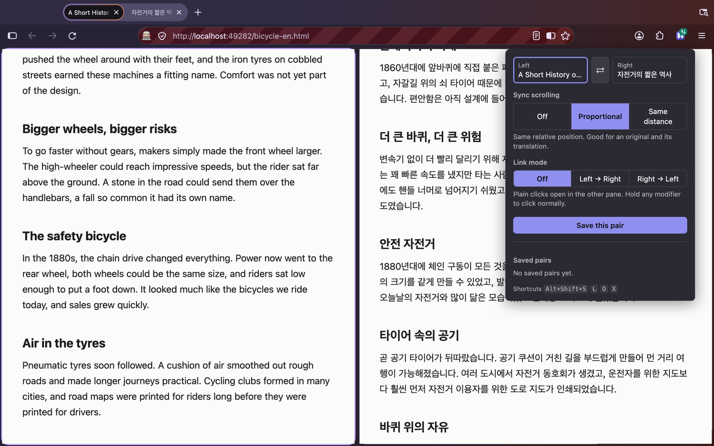
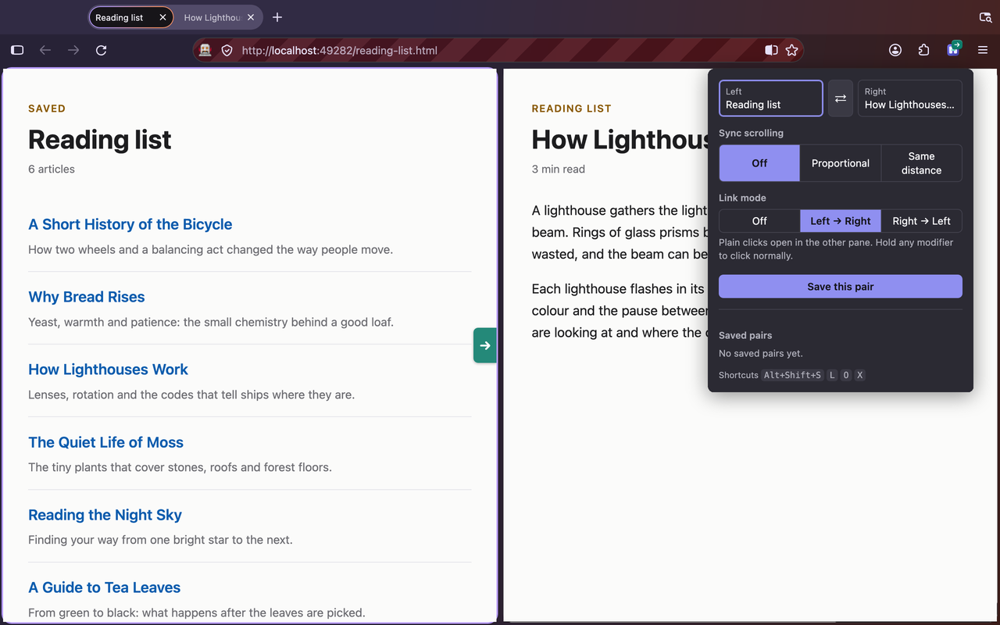

<p align="center">
  
</p>

<h1 align="center">Split Companion</h1>

Firefox's split view shows two tabs side by side, but the two panes don't know about each other. Split Companion connects them: scrolling one pane scrolls the other, and a link clicked in one pane can open in the other.

<p align="center"><a href="https://addons.mozilla.org/firefox/addon/split-companion/"><b>Install from Firefox Add-ons</b></a></p>



## Using it

Make a split first: hold Option (Alt on Windows/Linux) and click a second tab, or right-click a tab and choose Add Split View. Then use the toolbar popup or the shortcuts below.

| Shortcut | Does |
|---|---|
| `Alt+Shift+S` | Sync scrolling on/off |
| `Alt+Shift+L` | Link mode on/off; the pane you're in becomes the source |
| `Alt+Shift+O` | Focus the other pane |
| `Alt+Shift+X` | Swap left and right |

On macOS, Alt is Option. You can change the shortcuts in `about:addons`.

**Sync scrolling** has two modes. *Proportional* keeps both panes at the same relative position, which suits a document and its translation. *Same distance* scrolls both by the same number of pixels: align the panes once, then compare two versions of a page. When the page itself doesn't scroll (Gmail, Notion), it syncs the largest scrollable area instead.

**Link mode** turns one pane into a list and the other into a reader. Click a link on the left and it opens on the right; hold a modifier key to click normally. An arrow on the source pane's edge shows which way links go.



**Saved pairs** store two URLs and their settings. Restoring one opens both tabs; you then Option/Alt+click the second tab to split them, and the saved settings apply.

## What it can't do

Firefox lets extensions read a tab's split (`tabs.Tab.splitViewId`) and swap the panes (`tabs.move`), but not create a split. That's why you make the split yourself, and why restoring a saved pair stops at opening the tabs. Dragging a tab to split isn't possible either: Firefox doesn't support it, and the extension API can't add it (as of Firefox 159).

Content scripts don't run on local files (`file://`) or browser pages (`about:`, addons.mozilla.org); the popup says so when a pane is one of these. Needs Firefox 159 or newer.

## Development

Written in TypeScript and bundled into `dist/` with esbuild. `dist/` is the complete extension; web-ext runs, lints and packages that folder.

```bash
npm install
```

```bash
npm run dev
```

`npm run dev` starts esbuild in watch mode, a local server for the test pages (`http://127.0.0.1:8765`), and web-ext together. Edits rebuild and the extension reloads automatically. The test pages are served over `http://` because Firefox doesn't run extension content scripts on `file://` pages.

| Command | What it does |
|---|---|
| `npm run build` | Builds `dist/` |
| `npm run typecheck` | `tsc --noEmit` (the build doesn't check types) |
| `npm run lint` | Builds, then runs the AMO validator (`web-ext lint`) |
| `npm run test:e2e` | End-to-end tests |
| `npm run package` | Creates the release zip in `artifacts/` |

### End-to-end tests

The tests create a real native split in a real Firefox (via `gBrowser.addTabSplitView` in the chrome context) and observe the extension only through pages and extension APIs. They build `dist/` first and install that build.

```bash
uv run tests/e2e/test_split.py
```

With `HEADED=1` the browser window is visible, and on macOS the shortcut tests also run, using OS-level native key events (they're skipped in headless mode, where native key events aren't delivered). Set `FIREFOX_BIN` to use a different Firefox.

### Submitting to AMO

When the uploaded code is bundled, Mozilla asks for the original source and build instructions. `dist/` isn't minified so reviewers can read it. Submit the source with `package-lock.json` and these build steps:

```bash
npm ci && npm run build
```

## Layout

- `src/background.ts`: split tracking, state (`storage.session`), message routing, shortcuts, saved pairs
- `src/content.ts`: scroll measurement and syncing (with echo suppression), link interception, the link-direction arrow
- `src/popup.ts`: controls for the current split, saved pairs list
- `src/protocol.ts`: shared types and the message protocol; each message has a typed reply
- `src/firefox-split.d.ts`: Firefox 159 split view API types missing from `@types/firefox-webext-browser` (Firefox 143)
- `static/`: `manifest.json`, `popup.html`/`popup.css`, `_locales/{en,ko}`, icon; copied into `dist/` on build
- `scripts/build.mjs`: esbuild build; `scripts/dev.sh`: development runner
- `tests/e2e/`: end-to-end tests and fixture pages

## License

MIT. See [LICENSE](LICENSE).
